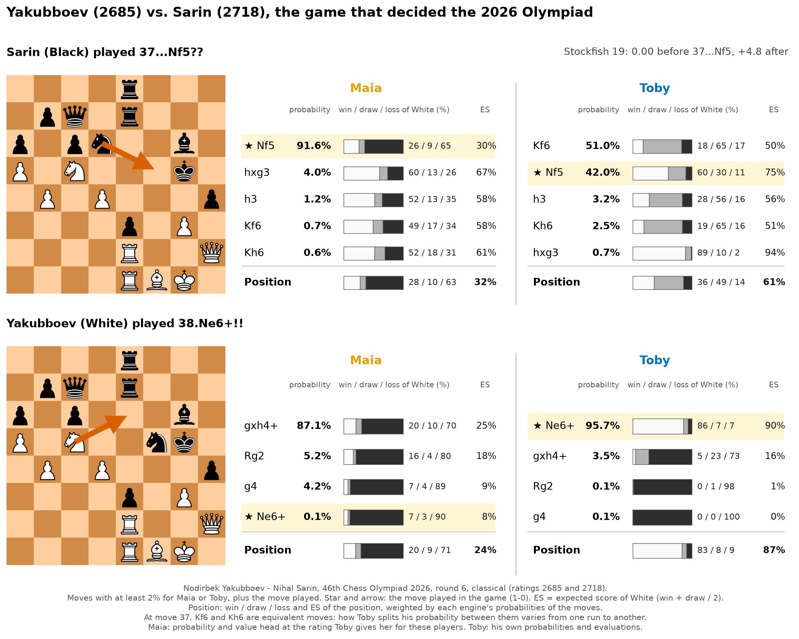

# Toby - The Oracle By Yosha

**A free, open-source chess engine that predicts what a human will actually play, and how good each move really is for that player.**

Give Toby the ratings of the two players and the time control: for every move, he returns the probability that it is played and its win / draw / loss. It works in ChessBase, Nibbler, and any UCI interface that shows MultiPV lines.

> **Method page (tests, results, failures):** [docs/METHOD.md](docs/METHOD.md)

*Yakubboev (2685) vs. Sarin (2718), Olympiad 2026. Maia gives the blunder 37...Nf5?? 91.6%; Toby gives it 42% and says the position is dangerous for Black (61% expected score for White), where Stockfish says 0.00. On the next move, Maia ignores the winning 38.Ne6+!! (0.1%); Toby gives it 96%.*

## The idea

* **Maia-3** predicts human moves, by intuition: she was trained on millions of games, but she does not calculate.
* **Leela** calculates, but plays like a 3600-Elo player: far too well to predict a human.
* **Toby** combines both, like a human player does: Maia gives the probability of each move, Leela measures how much expected score each move loses, and one rule lowers the probability of the moves that lose, more strongly for stronger players.

The evaluation is given as win / draw / loss for a player of that level, against that opponent, in that time control, over the board or online.

## Results

Tested on games never used for tuning, with the rules and success criteria written down before the test (classical: 1,500 games).

| | Real players | Maia (with Toby's rating boost) | Toby |
|---|---|---|---|
| Move actually played found as #1 | - | 55.3% (52.4% at the player's real rating) | **58.7%** |
| Blunders (share of moves) | 3.5% | 8.9% | **3.5%** |

The gain is large in classical, smaller in rapid, small in blitz. Full results, including the criteria that failed, are on the [method page](docs/METHOD.md).

## Download

| Package | Size | Contains | Take it if |
|---|---|---|---|
| **Toby-full** (default) | 1.4 GB | Toby, Maia-3, Leela (`lc0`, CUDA 12) and the BT3 network | You want it to work right away. |
| **Toby-Maia** | 0.63 GB | Toby and the Maia-3 weights | You already have Leela (`lc0`) and a network. |
| **Toby-Leela** | 1.09 GB | Toby, `lc0` and the BT3 network | You already have the Maia-3 weights. |
| **Toby-core** | 0.33 GB | Toby only | You have both Leela and Maia. |

**Download:** [Toby-full.zip](https://github.com/Yosha87/Toby/releases/latest/download/Toby-full.zip) - [Toby-Maia.zip](https://github.com/Yosha87/Toby/releases/latest/download/Toby-Maia.zip) - [Toby-Leela.zip](https://github.com/Yosha87/Toby/releases/latest/download/Toby-Leela.zip) - [Toby-core.zip](https://github.com/Yosha87/Toby/releases/latest/download/Toby-core.zip)

Unzip anywhere (Windows 64-bit): everything is in the `Toby` folder, then add `toby.exe` as a UCI engine. Leela is fast on an NVIDIA graphics card (2 to 3 seconds per position on a laptop GPU); Maia's prediction appears immediately. Tested on one Windows 11 computer with an NVIDIA laptop GPU, in ChessBase and in Nibbler.

Using your own Maia or Leela

Toby looks for its components next to itself (folders `lc0/`, `nets/`, `maia/`), then on your PATH. To use other versions, set these environment variables:

| Variable | Meaning |
|---|---|
| `TOBY_LC0` | Full path of `lc0` |
| `TOBY_NET` | Full path of the Leela network (`.pb.gz`) |
| `TOBY_MAIA_WEIGHTS` | Full path of the Maia-3 weights (`maia3-79m.pt`) |
| `TOBY_MAIA_REPO` | A clone of the [Maia-3 repository](https://github.com/CSSLab/maia3), if you run Toby from the Python source |
| `TOBY_DEVICE` | `cpu` (default) or `cuda`, for Maia |

## Options

| Option | Meaning |
|---|---|
| `White Rating`, `Black Rating` | The ratings of the two players (0 = not set). If you fill only one, both sides get that rating; if you fill both, Toby also uses the opponent's rating. |
| `Rating Source` | Where the ratings come from: FIDE, Lichess Classical / Rapid / Blitz, Chess.com Rapid / Blitz. FIDE means over the board (OTB); Lichess and Chess.com mean online. |
| `Time Control` | Classical, Rapid, or Blitz. Each mode has its own rule. |
| `Display` | ChessBase, Nibbler, or Standard (detected automatically). |

Nibbler: small scripts in `nibbler_scripts` set the time control and the ratings in three clicks.

## Limits

* Blitz: the gain is small and was not demonstrated on the pre-registered test.
* Puzzle-like positions (one move much better than the second best): Toby underestimates the player to move by 6 to 8 points (Maia: 12).
* Leela's search is not deterministic: the numbers can differ by a point or two from one analysis to the next.
* A larger search (4,096 nodes) was tested and did not predict better: Toby keeps 1,024.

More on the [method page](docs/METHOD.md).

## Quick start

Unzip a package, then add `toby.exe` (in the `Toby` folder) as a UCI engine in your interface.

**ChessBase:** Engines > Create UCI engine > choose Toby; open its options and set White Rating, Black Rating, Rating Source, Time Control and Display = ChessBase. Start an analysis and wait a few seconds.
In the lines, the score column is the percentage of players of that rating who play the move, and the bar / numbers are its win, draw and loss. When it is Black's turn ChessBase shows the numbers with a minus sign: read the absolute value.

**Nibbler:** Engine > Choose engine > Toby (Toby detects Nibbler by itself). Each line reads `52.9%  d4  (N: 45.67%, P: 34.43%, WDL: 436 235 329)`: expected result of the move, `N` = Toby's probability, `P` = Maia's probability before the correction, `WDL` = win / draw / loss in per mille.
Copy the files of `nibbler_scripts` into Nibbler's scripts folder (menu Engine > Custom scripts) to set the time control and the ratings in three clicks.

While it thinks: Maia's prediction appears at once, a first correction after about a second, the final result after 2 to 3 seconds.

## Licence and credits

* Toby: **AGPL v3** (see `LICENSE` and `NOTICE.md`).
* Maia-3: AGPL v3. Leela Chess Zero: GPL v3.
* BT3 network: made by the [Leela Chess Zero](https://lczero.org/play/networks/bestnets/) team and shipped unmodified, as downloaded from lczero.org. No explicit license is stated for it.
* Rating conversion tables: [ChessGoals](https://chessgoals.com/rating-comparison/), a public page that compiles Chess.com and Lichess data.
* Games used for the tests: TWIC (OTB) and Lichess (CC0).

## Contributing and support

Toby can be used for broadcasts, training, opening preparation, anti-cheating, bot creation, etc. Contributions are welcome: code, games, and tests in other chess interfaces.

I have dedicated hundreds of hours to Oracle and Toby. If you value my work, please consider [making a donation](https://www.paypal.com/donate/?hosted_button_id=6WTAEDBXAPTLC).
