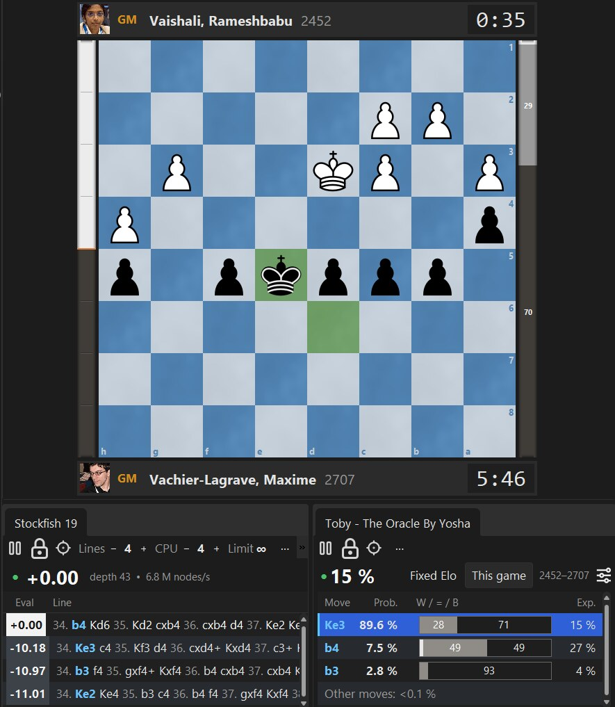
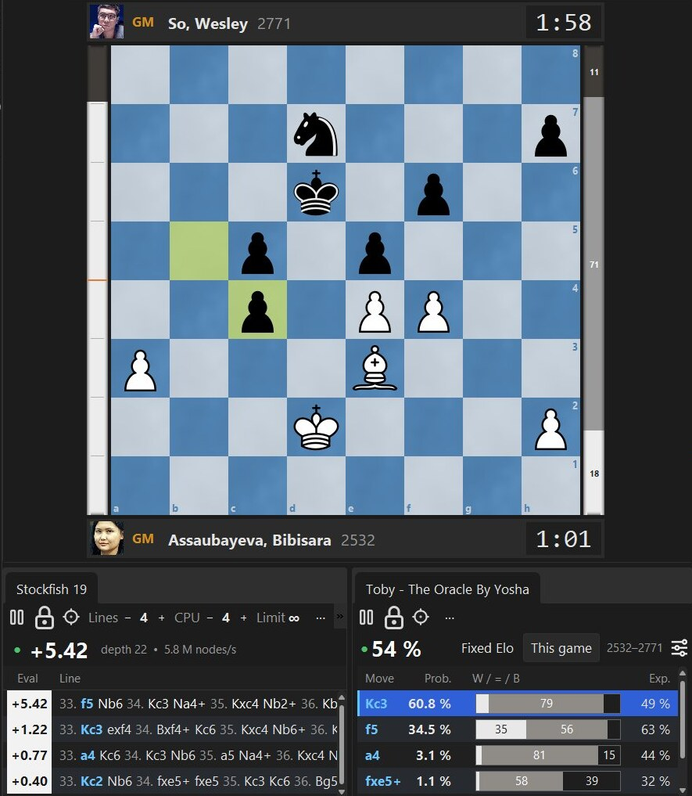
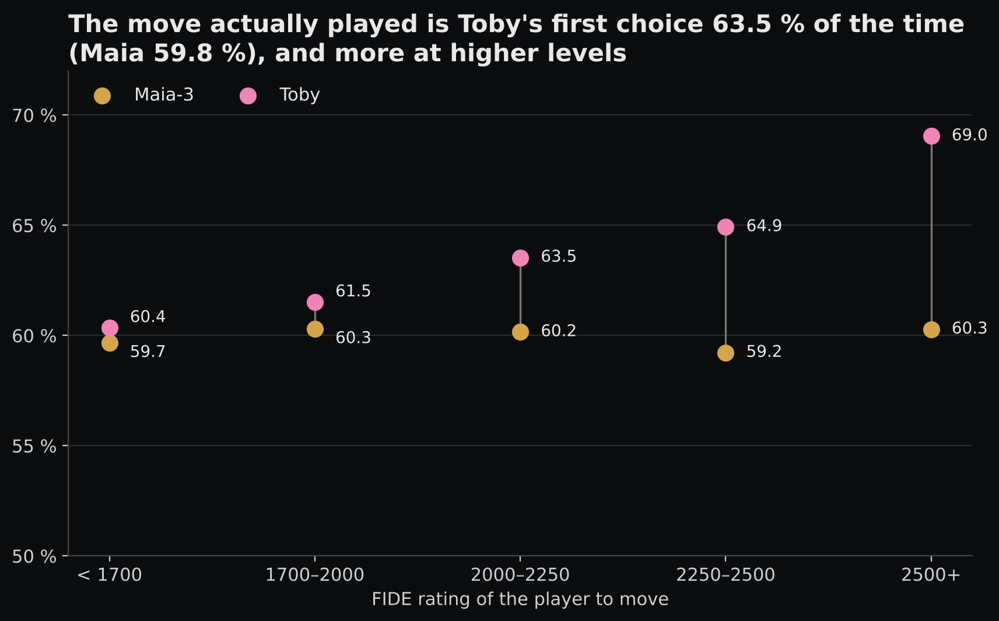
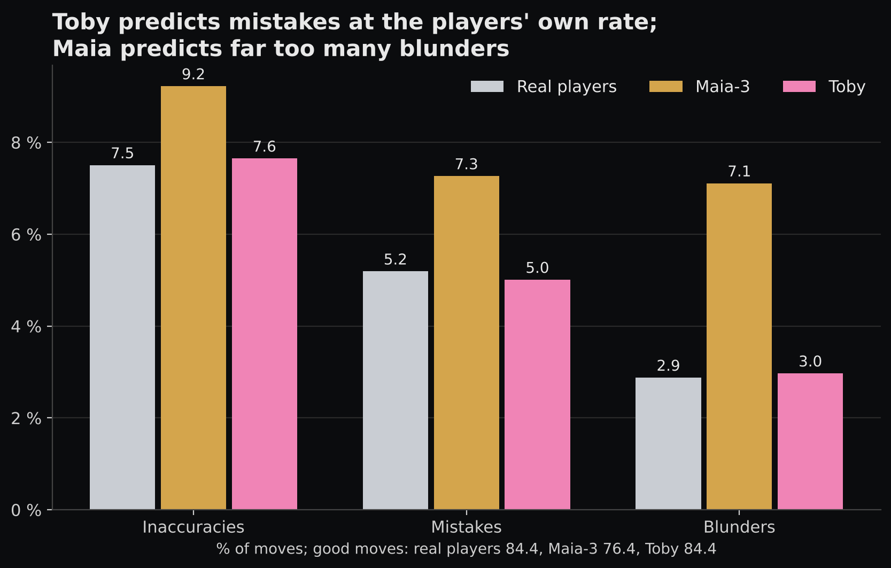
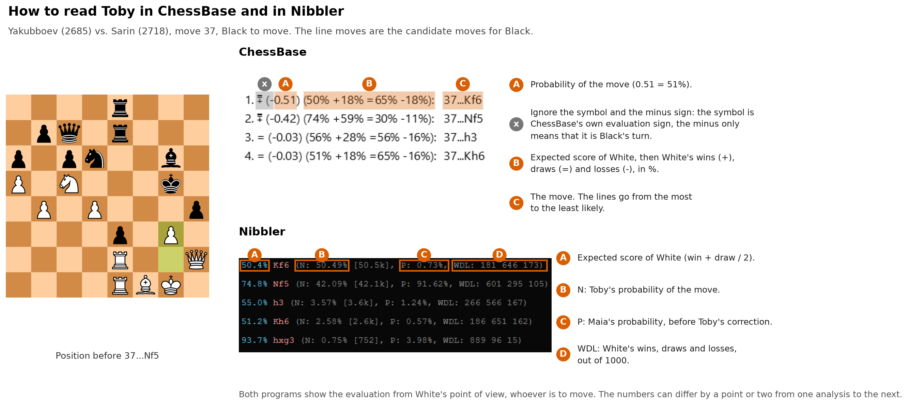

# Toby - The Oracle By Yosha

**The best human-like chess engine, free and open-source: Maia's intuition, corrected by calculation (Leela and Stockfish).**

The first human-like chess engine for every level and every time control. Toby predicts the moves humans play, from beginner to 2900, in classical, rapid and blitz, and what each move is worth for them: win, draw or loss for players of that level, against that opponent. A UCI engine for ChessBase, Nibbler or any interface that shows several lines, and best used with Siby.

## Centipawns suck: Toby gives useful evaluations

A position is only ever won, drawn or lost. Every other evaluation is practical: true for some players, in some conditions. Stockfish's evaluations are true for Stockfish against itself: it ignores who is playing, the clock and the risk of a blunder. Toby gives the chances of winning, drawing and losing for the two players of the game, from their ratings, the time control, over the board or online, and the moves they are likely to play, blunders included.

**Dead draw? Really, Stockfish?** Stockfish says 0.00. Toby tells the real story: even at Vaishali's level, the likeliest move is the blunder 34.Ke3?? (89.6 %), which she played, and the best move, 34.b4!!, would not have ended her problems: about one chance in two of a draw, one in two of losing.

Vaishali - Vachier-Lagrave, Total Chess World Championship Tour 2026, before 34.Ke3??

**Totally winning, or likely a draw?** Stockfish says +5.42. Toby: 18 % wins, 71 % draws, 11 % losses. Assaubayeva would find the only crushing move, 33.f5!!, about one time in three; the move she played, 33.Kc3, was the likeliest, and after it a draw was the likeliest result.

Assaubayeva - So, Total Chess World Championship Tour 2026, before 33.Kc3

## The idea

> **Human thinking = intuition + analysis = System 1 + System 2**

* **Maia-3** predicts human moves by intuition, but does not calculate: it blunders far more than real players (7.1 % of its moves vs 2.9 % in classical).
* **Leela** and **Stockfish** calculate, but play far too well to predict a human.
* **Toby** combines both, like a human player: small neural networks, trained on real games, correct Maia's probabilities with the value of each move computed by the engines.

Toby is the full version of [Oracle](https://github.com/Yosha87/Oracle) (2024), the proof of concept of this approach. *Yosha Iglesias*

## Results

Sealed test of November 2026: games never used before, with the rules written and frozen before the games were downloaded.

| Classical, move played = first choice | Maia-3 | **Toby Fast** | **Toby Accurate** |
|---|---|---|---|
| All levels | 59.8 % | **62.8 %** | **63.5 %** |
| 2500+ | 60.3 % | **67.0 %** | **69.0 %** |

12,580 positions of 1,268 over-the-board classical games (26 October - 9 November 2026). Level = FIDE rating of the player to move.

* **The gain grows with the level:** small below 2000, +6 to +9 points of first choices above 2250.
* **Mistakes like real players:** with moves drawn from Toby's probabilities, blunders are 3.0 % of the moves in classical (real players 2.9 %, Maia 7.1 %).
* **In rapid, blitz and online, Toby is close to Maia.** The clear gain is in classical.

Same 12,580 positions; moves drawn at random from each engine's probabilities.

Details, all the tests and what failed: [method page](docs/METHOD.md).

## Two settings

| `Precision` | What it uses |
|---|---|
| **Accurate** (default) | In classical with an NVIDIA graphics card: Leela's search + Stockfish 19. Otherwise the same as Fast. |
| **Fast** | In classical: Stockfish 19 + one Leela evaluation per move. In rapid and blitz: Stockfish 19. Any computer. |

Speed on a test machine (4 processor cores, NVIDIA T4): about 0.5 s per position in Fast and 3 s in Accurate with the graphics card; about 1.2 s on the processor alone. The first answer after starting takes a few seconds more.

## Download

**Toby 1.0** (November 2026).

| Package | For |
|---|---|
| [Toby-full.zip](https://toby.tribychess.org/Toby-full-2026-11-13.zip) (3.9 GB) | Windows with an NVIDIA graphics card |
| [Toby-light.zip](https://toby.tribychess.org/Toby-light-2026-11-13.zip) (0.9 GB) | Windows, any computer |
| [Toby-core.zip](https://toby.tribychess.org/Toby-core-2026-11-13.zip) (0.17 GB) | Toby only, if you have the components |
| [Toby-linux-full.zip](https://toby.tribychess.org/Toby-linux-full-2026-11-13.zip) (4.1 GB) | Linux (glibc 2.35+) with an NVIDIA graphics card |
| [Toby-linux-light.zip](https://toby.tribychess.org/Toby-linux-light-2026-11-13.zip) (1.0 GB) | Linux (glibc 2.35+), any computer |

Checksums: [toby_manifest.json](https://toby.tribychess.org/toby_manifest.json). Unzip, then add `Toby/toby.exe` (Linux: `Toby/toby`) as a UCI engine. If Windows complains about `c10.dll`, install the [Visual C++ redistributable](https://aka.ms/vs/17/release/vc_redist.x64.exe).

Using your own components

Toby looks for its components next to itself (`maia/`, `stockfish/`, `lc0/`, `nets/`), then on your PATH. Environment variables: `TOBY_STOCKFISH`, `TOBY_LC0`, `TOBY_NET` (Leela network), `TOBY_MAIA_WEIGHTS`, `TOBY_MAIA_FT` (fine-tuned classical weights), `TOBY_MAIA_REPO` (to run from the Python source), `TOBY_DEVICE` (`auto`, `cpu`, `cuda`), `TOBY_BACKEND` (lc0 backend).

From source: `pip install -r requirements.txt`, clone [Maia-3](https://github.com/CSSLab/maia3), run `python toby_uci.py`.

Toby is validated with Stockfish 19, lc0 v0.32 and the BT3-768x15x24h-swa-2790000 network only. Other versions run, with no guarantee.

## Options

| Option | Meaning |
|---|---|
| `White Rating`, `Black Rating` | The ratings of the two players. |
| `Rating Source` | FIDE (over the board), Lichess or Chess.com (online). |
| `Time Control` | Classical, Rapid or Blitz. |
| `Precision` | Accurate (default) or Fast. |
| `Endgame Evaluation` | M (default) or Off: a win / draw / loss that accounts for how humans of that level convert or hold endgames. |
| `Deepening` | On (default): in infinite analysis, refines the win / draw / loss of the most likely moves. |
| `Display` | ChessBase, Nibbler or Standard (detected automatically). |

## Limits

* The clear gain over Maia is in classical; in rapid, blitz and online, Toby is close to Maia.
* At 2500+ in classical, Toby still blunders a little too often (about 1.7 % of its moves vs 1.1 % for real players).
* Accurate needs an NVIDIA graphics card; without one, Toby uses Fast. On a computer with an NVIDIA driver but no usable graphics card, the first answer can take about 2 minutes (then about 1 s).
* Lichess and Chess.com ratings are converted to FIDE with public tables (margin of about 70 to 115 points).
* Tested on games of 2026 only.

## Coming soon: Triby

**Siby**, my free chess GUI built around Toby, and **Gaby**, a database of more than 13 million games. Toby, Siby and Gaby: **Triby**, free, open source and without ads.

## Quick start

Unzip a package, then add `toby.exe` (in the `Toby` folder) as a UCI engine in your interface.

**ChessBase:** Engines > Create UCI engine > choose Toby; open its options and set White Rating, Black Rating, Rating Source, Time Control and Display = ChessBase. Start an analysis and wait a few seconds.
In the lines, the score column is the percentage of players of that rating who play the move, and the bar / numbers are its win, draw and loss. When it is Black's turn ChessBase shows the numbers with a minus sign: read the absolute value.

**Nibbler:** Engine > Choose engine > Toby (Toby detects Nibbler by itself). Each line reads `52.9%  d4  (N: 45.67%, P: 34.43%, WDL: 436 235 329)`: expected result of the move, `N` = Toby's probability, `P` = Maia's probability before the correction, `WDL` = win / draw / loss in per mille.
Copy the files of `nibbler_scripts` into Nibbler's scripts folder (menu Engine > Custom scripts) to set the time control and the ratings in three clicks.

While it thinks: Maia's prediction appears at once, then Toby's final result.

## Licence and credits

* Toby: **AGPL v3** (`LICENSE`, `NOTICE.md`).
* Shipped in the packages, with their own licences:
  * [Maia-3](https://github.com/CSSLab/maia3) (University of Toronto CSSLab), AGPL v3: code and [79M weights](https://huggingface.co/UofTCSSLab/Maia3-79M) unmodified; the classical weights are **modified** (fine-tuned for Toby on 1.3 million over-the-board classical games), AGPL v3.
  * [Stockfish 19](https://github.com/official-stockfish/Stockfish/tree/sf_19), official build: GPL v3.
  * [Leela Chess Zero, lc0 v0.32.1](https://github.com/LeelaChessZero/lc0/tree/v0.32.1): GPL v3 with an additional permission for the NVIDIA libraries. Toby-full: the official CUDA 12 release, unmodified. Toby-light (Windows): the official `onnx-dml` release, unmodified, run with the `onnx-cpu` backend, with its ONNX Runtime (MIT). Toby-linux packages: built from that source with a small build patch shipped in the package, with ONNX Runtime 1.20.1 (MIT).
  * The BT3 network of the [Leela Chess Zero](https://lczero.org/play/networks/bestnets/) team, unmodified.
  * [PyTorch](https://github.com/pytorch/pytorch), [NumPy](https://github.com/numpy/numpy) (BSD-3-Clause), [python-chess](https://github.com/niklasf/python-chess) (GPL v3).
* Rating tables: [ChessGoals](https://chessgoals.com/rating-comparison/). Games: The Week in Chess and Lichess (CC0).

## Support

Contributions are welcome: code, games, tests in other interfaces. I have spent hundreds of hours on Oracle and Toby; if you value this work, please consider [a donation](https://tribychess.org/support).

<a href="https://tribychess.org/support"><strong>Support Triby</strong></a>

