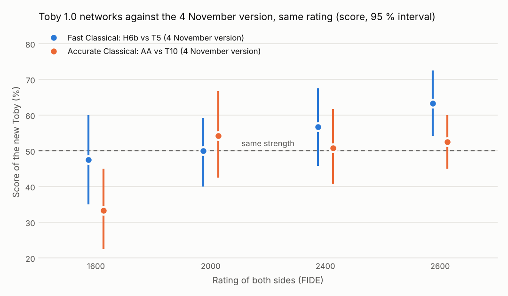

# Toby - Method, tests, and results

*Last updated 2026-11-12 (Toby 1.0, sealed test v6).*

Toby applies my formula **Human Thinking = Intuition + Analysis = System 1 + System 2** (Daniel Kahneman's two systems) to human chess moves: intuition (Maia) corrected by calculation (Leela and Stockfish). It is the full version of Oracle, my proof of concept of this approach in 2024 ([GitHub](https://github.com/Yosha87/Oracle), [article](https://yoshachess.com/article/oracle-best-human-like-chess-engine/)).

This page describes how Toby works and how it was tested. Every number here was measured on the networks and settings released in Toby 1.0, against Maia-3.

## 1. How Toby is tested

* **Sealed tests.** The test games were never used for anything before the test: not for training, not for choosing settings. The protocol (which games, which measures, the success criteria and the decisions that follow) was written, dated and committed to the development repository, with the hashes of every input, before the games were downloaded (10 November 2026), and the analysis was run once. That repository is private.
* **Uncertainty.** Every difference comes with a 95% confidence interval from a bootstrap that resamples whole games (1,000 draws).
* **Positions.** Up to 10 positions per game, drawn at random between half-moves 20 and 99 (the main sample), with the game's previous moves; the opening (half-moves 1-19) and long endgames (100+) are separate samples with their own criteria. Levels are the FIDE-equivalent rating of the player to move.

| Time control | Test games | Positions (half-moves 20-99) |
|---|---|---|
| Classical (over the board) | 1,268 games of 26 October - 9 November 2026, FIDE standard time control **measured from the players' clocks**: 1,053 from the Lichess broadcasts of 1-9 November, 44 from The Week in Chess (events checked against those broadcasts) and 171 over-the-board games of 26-31 October from another collection; up to 250 games per rating band (400 at 2250-2500, all 118 available at 2500+) | 12,580 |
| Rapid and blitz (over the board) | 349 games of the same broadcasts, rapid or blitz by their clocks | 3,490 |
| Rapid and blitz (online) | 1,984 rated Lichess games of 1-9 November 2026 (989 rapid, 995 blitz), about 100 per band of the players' Lichess rating from 600 to 2600+ | 19,840 |

## 2. How Toby predicts the move

1. **Maia-3** (79 M parameters) gives, for every legal move, the probability that a human plays it. It is given the previous positions of the game and an input rating.
   * In classical: a **Maia-3 fine-tuned on 1,299,033 over-the-board classical games** (105 million positions, from the released weights), at an input rating mapped from Toby's strength estimate E (fitted on training games so that each level's moves are best predicted). The games: over-the-board broadcasts on Lichess (2020 to June 2026) whose time control was measured from the clocks and is FIDE standard; games of The Week in Chess (TWIC) from events whose games were checked against those broadcasts; and TWIC games before 2020, minus the event families found to include rapid or online games. None of the test games.
   * In rapid and blitz: the released Maia-3 at the player's Lichess rating (a Chess.com rating through its Lichess equivalent, a FIDE rating through the tables; at most 2800).
2. **The calculators** give the value of every move:
   * `Precision = Fast` in classical: **Stockfish 19** (150,000 nodes for every move, then 250,000 on the candidates: Maia's three first choices and Stockfish's two best moves) plus **one evaluation of the position by Leela** (lc0 0.32, BT3 network, raw policy, no search). Leela runs on the NVIDIA graphics card, or on the processor if there is none.
   * `Precision = Accurate` in classical with an NVIDIA graphics card: **Leela's search** (1,024 nodes), with the moves Leela barely explored valued by Stockfish 19 (converted to Leela's scale by a table fitted on the training data), and the same Stockfish values given to the network too. Without an NVIDIA card, Accurate is Fast.
   * Rapid and blitz (both settings): **Stockfish 19 alone** (300,000 nodes, every legal move in one search).
3. **The correction**: score = ln p_Maia + f(context, move), then a softmax over the legal moves. f is a small neural network; one per setting: **H6b** (Fast, classical), **AA** (Accurate, classical), **R10** (rapid and blitz). Its inputs: Maia's probability of the move (at the input rating and at the player's own rating), the move's value and its loss against the best move in expected score (never raw centipawns), Leela's policy where Leela is used, the value of the position, the ratings of both players, the time control, over the board or online, and a few features of the position. Untrained, the network is Maia. The networks are trained by maximum likelihood of the move played on real games (over the board and online), with separate development games for early stopping and for choosing between candidates; no test game.

E is the strength as a FIDE-equivalent rating: Lichess and Chess.com ratings are converted with the tables of [ChessGoals](https://chessgoals.com/rating-comparison/), a public page that compiles Chess.com and Lichess data (margin of +/- 70 to 115 points). The tables have no data below a FIDE equivalent of about 1660: below, one FIDE point is counted as one Lichess point (Chess.com through its Lichess equivalent), so that the conversion and its inverse agree exactly and Maia always receives the player's own Lichess rating. Such a strength is a convention, not a measure: Toby shows it as "E <= 1400" (below FIDE's lowest rating) or "by convention".

**Why the time control was measured.** Classifying games as classical by the name of the event is not enough. Among TWIC games labelled classical by their event name and also found in the Lichess broadcasts, the clocks show a starting time under 30 minutes for 31% of them in 2020, 16% in 2021, and still 3 to 6% each year since 2022 (World Cup tie-breaks, Champions Chess Tour, rapid Grand Prix events...). Toby's classical training games were therefore checked against the clocks.

## 3. The evaluation (win / draw / loss)

* For each move, Toby estimates the win, draw and loss of **a player of that level** against a player of that level, not of a perfect engine. With Stockfish it is computed for the 12 most probable moves.
* It combines the engine's expected score and Maia's value head in a Davidson-type three-outcome model: the difference between the two sides sets the win / loss balance; a draw term depends on the strength of the players, on how unbalanced the position is, and on Maia's draw estimate. Constants are fitted on real game results, per time control, with separate over-the-board and online constants, and a set that uses the opponent's rating when it is given. An endgame term corrects the evaluation where a human of a given level does not always convert or hold what the engine sees.
* **Endgame Evaluation = M** (default): the evaluation of the position is the expectation of its moves' evaluations under Toby's probabilities, so it includes the chance that this player plays each move of this position.
* **Deepening** (default, in infinite analysis): after the first answer, Toby evaluates the position after the three most probable moves and after the move with the best evaluation, and blends that next position's own evaluation into those moves' evaluations (one updated block).

## 4. Results (sealed test v6)

### 4.1 Move prediction, classical

Log-likelihood of the move actually played (higher is better) / share of positions where it is the first choice, 12,580 positions:

| | Maia-3 | **Toby Fast (H6b)** | **Toby Accurate (AA)** (default) |
|---|---|---|---|
| All levels | -1.168 / 59.8% | **-1.079 / 62.8%** | **-1.065 / 63.5%** |
| below 1700 | -1.177 / 59.7% | -1.168 / 60.3% | -1.165 / 60.4% |
| 1700-2000 | -1.171 / 60.3% | -1.134 / 61.5% | -1.132 / 61.5% |
| 2000-2250 | -1.170 / 60.2% | -1.099 / 62.6% | -1.087 / 63.5% |
| 2250-2500 | -1.176 / 59.2% | -1.032 / 64.0% | -1.010 / 64.9% |
| 2500+ | -1.118 / 60.3% | -0.894 / 67.0% | -0.857 / 69.0% |

Maia-3 here is given the previous moves and the rating Toby gives it.

* Gain over Maia-3 in log-likelihood: +0.089 (Fast) and +0.103 (Accurate). Against the networks of the 4 November development version (Fast T5, Accurate T10): Fast +0.016 [+0.011; +0.020] and +0.5 point of first choices; Accurate +0.006 [+0.004; +0.008] and +0.25 point.
* The gain over Maia grows with the level: below 1700 Toby is close to Maia; from 2250 its first choice is right 5 to 9 points more often.

### 4.2 Move prediction, rapid and blitz

Same measures, 23,330 positions of 2,333 games (Toby = R10, the same in both settings):

| | Positions | Maia-3 | **Toby** | Toby - Maia-3, log-likelihood [95%] |
|---|---|---|---|---|
| All | 23,330 | -1.247 / 58.1% | **-1.234 / 58.5%** | +0.014 [+0.011; +0.016] |
| Rapid, online | 9,890 | -1.279 / 57.8% | -1.265 / 58.3% | +0.013 [+0.010; +0.017] |
| Blitz, online | 9,950 | -1.241 / 58.1% | -1.237 / 58.2% | +0.004 [+0.001; +0.006] |
| Rapid, over the board | 1,290 | -1.205 / 58.1% | -1.143 / 59.2% | +0.062 [+0.041; +0.082] |
| Blitz, over the board | 2,200 | -1.161 / 60.0% | -1.130 / 60.9% | +0.032 [+0.022; +0.042] |

**Online, Toby is barely better than Maia-3** (about +1% of probability on the move played in rapid, +0.5% in blitz); over the board the gain is larger but rests on fewer games. (Maia-3's column was computed after the test from the same sealed data; it is reported, not a criterion.)

### 4.3 Mistakes (one move drawn at random from the probabilities; judge: Stockfish 19, 2 million nodes per move)

Losses are measured in expected score at the level of the player to move (blunder: more than 20 points; mistake: 10 to 20).

| | Real players | Maia-3 | Toby Fast | Toby Accurate |
|---|---|---|---|---|
| Classical, blunders | 2.9% | 7.1% | 3.2% | **3.0%** |
| Classical, mistakes | 5.2% | 7.3% | 5.2% | **5.0%** |
| Classical 2500+, blunders | 1.1% | 8.4% | 2.0% | 1.7% |
| Rapid and blitz, blunders | 6.7% | - | 6.9% | 6.9% |

In classical, Maia, which does not calculate, gives far too much probability to blunders; Toby's mistakes are close to the real ones, except at 2500+, where it still blunders too often (section 6).

**Playing level** (reported, not a criterion): mean loss in expected score of a move drawn from the network minus that of the move actually played, in points per move. Classical: Fast +0.19 [+0.08; +0.28], Accurate +0.02 [-0.08; +0.12], Maia-3 +2.12; at 2500+: Fast +0.60, Accurate +0.39, Maia-3 +3.74. Rapid and blitz: Toby +0.13 [+0.03; +0.24] (4.7 points per move against the players' 4.6), Maia-3 +0.90. No network plays clearly too strong; all play a little too weak at 2500+, mostly through blunders.

### 4.4 Evaluation (win / draw / loss of the position, against the game result)

Both options were checked on the sealed games, each against the evaluation without it, with the log-likelihood of the game result (both ratings given; positions of every half-move):

* **Endgame Evaluation M** against Off: +0.0047 [+0.0013; +0.0081] (3,601 games), no significant loss in any time control or level: on by default everywhere.
* **Deepening** against M: +0.0047 [+0.0040; +0.0057], positive in every time control and level band: on by default in analysis.

Calibration of the released evaluation (Fast, both ratings, M + Deepening; computed after the test from the same data, reported only). Log-loss of the result (lower is better; a constant forecast with the group's own proportions in brackets) and mean gap between the announced expected score and the actual score (10 groups of positions):

| | Positions | Log-loss | Gap |
|---|---|---|---|
| Classical, over the board | 17,188 | 0.715 (1.095) | **0.9 point** |
| Rapid, over the board | 1,763 | 0.704 (1.032) | 2.4 points |
| Blitz, over the board | 3,025 | 0.720 (1.049) | 2.1 points |
| Rapid, online | 13,338 | 0.713 (0.896) | 3.0 points |
| Blitz, online | 13,379 | 0.775 (0.909) | 1.3 points |

In classical the announced expected score is within about one point of the actual score on average; in rapid and blitz the gap is larger.

### 4.5 Matches (Toby against Toby, and against Maia-3)

Engine as shipped, moves drawn from the probabilities, classical, clocks 90 min + 30 s, both sides at the same rating; 30 openings (after half-move 16) each played with both colours: 60 games per cell. Judge: Stockfish 19, 1 million nodes. 95% intervals by bootstrap over the openings.

**Toby 1.0 against the 4 November development version** (the networks published as a working step on 4 November: T5 for Fast, T10 for Accurate), score of Toby 1.0:

| Rating | Fast: H6b vs T5 | Accurate: AA vs T10 |
|---|---|---|
| 1600 | 47.5% [35.0; 60.0] | **33.3% [22.5; 45.0]** |
| 2000 | 50.0% [40.0; 59.2] | 54.2% [42.5; 66.7] |
| 2400 | 56.7% [45.8; 67.5] | 50.8% [40.8; 61.7] |
| 2600 | **63.3% [54.2; 72.5]** | 52.5% [45.0; 60.0] |

Fast is stronger at 2600 (about +95 Elo), as expected: the 4 November Fast network blundered too much above 2250. Accurate is the same at 2000-2600 but **weaker at 1600** (about -120 Elo; it blundered more in these games, 4.5 against 4.0 per 100 moves), although on the human positions of the sealed test its blunders below 1700 match the real players' (3.9% against 4.0%). A head-to-head measures relative strength, not faithfulness to human play; the sealed test measures the latter.

**Toby (Fast) against Maia-3 alone** (Maia's input rating: min(R + 700, 2900)): Toby scores 75.8% at 1600, 91.7% at 2000, 99.2% at 2400 and 95.8% at 2600 (114 wins, 6 draws, 0 losses in the 120 games at 2400 and 2600). Maia-3 blunders 5 to 6.6 times per 100 moves at every rating; Toby goes from 5.0 at 1600 to 1.1 at 2600.

## 5. How the 1.0 networks were chosen, and what was not kept

* The sealed test compared candidates with the networks of the 4 November version, with criteria fixed in advance (prediction overall and per level, mistakes, the opening and long-endgame samples). **Fast, classical:** H6b was the only candidate to pass every criterion (the five other candidates failed the long-endgame sample, one of them also a level band). **Rapid and blitz:** no candidate passed (two hybrid networks with Leela's policy failed the long-endgame sample and the blunder criterion at 2250+): R10, the Stockfish-only network, stays.
* **Accurate, classical: AA was adopted after the results, outside the protocol's rule.** The rule kept T10: AA failed only the long-endgame sample (half-moves 100+, 805 positions), for lack of evidence rather than because it is worse there (log-likelihood -0.0007 [-0.011; +0.011]). It passed every other criterion, is better overall (+0.006 log-likelihood) and above 2000, and blunders as T10 does. This decision was taken by Yosha Iglesias and recorded openly in the protocol; the next sealed test re-tests AA with enough late positions.
* More Stockfish nodes: no gain beyond about 250,000 nodes (100,000 are enough in blitz).

## 6. Limits

* Online, Toby is barely better than Maia-3 used at the player's own rating. The clear gain is in classical, above 2000.
* At 2500+ in classical, Toby still blunders too often: about 1.7% of its moves with Accurate and 2.0% with Fast, real players 1.1%. This is the main target of the next version.
* Accurate needs an NVIDIA graphics card; without one, Toby uses Fast. Accurate at 1600 lost its match against the 4 November version (section 4.5).
* Ratings are converted between FIDE, Lichess and Chess.com with public tables (margin of about 70 to 115 points). Below a FIDE equivalent of about 1660 they have no data: the strength shown there is a convention.
* The tests use recent games (2026). Other periods or contexts were not tested.
* Toby is validated with Stockfish 19, lc0 v0.32 and the BT3-768x15x24h-swa-2790000 network. Newer versions run (their version is shown in Toby's summary line), but without guarantee: they have to be tested before they are validated.
* The win / draw / loss evaluation is very reliable in classical; in rapid and blitz it is less well calibrated (section 4.4).

## 7. Data

* **Games:** The Week in Chess (over the board), Lichess (rated games, no bots; CC0) and the Lichess broadcast database (over-the-board events). Test games are absent from all training and tuning data. None of these game collections is redistributed with Toby.
* **Hardware:** rented GPUs (RTX 3090 / 4090, A40, L40S) for Leela, Maia and the fine-tuning, CPU servers for Stockfish.

## 8. Checking

The protocols (written and tagged before the test games were opened), the full result reports including the failed criteria, the scripts and the list of test games are kept in a private development repository.

